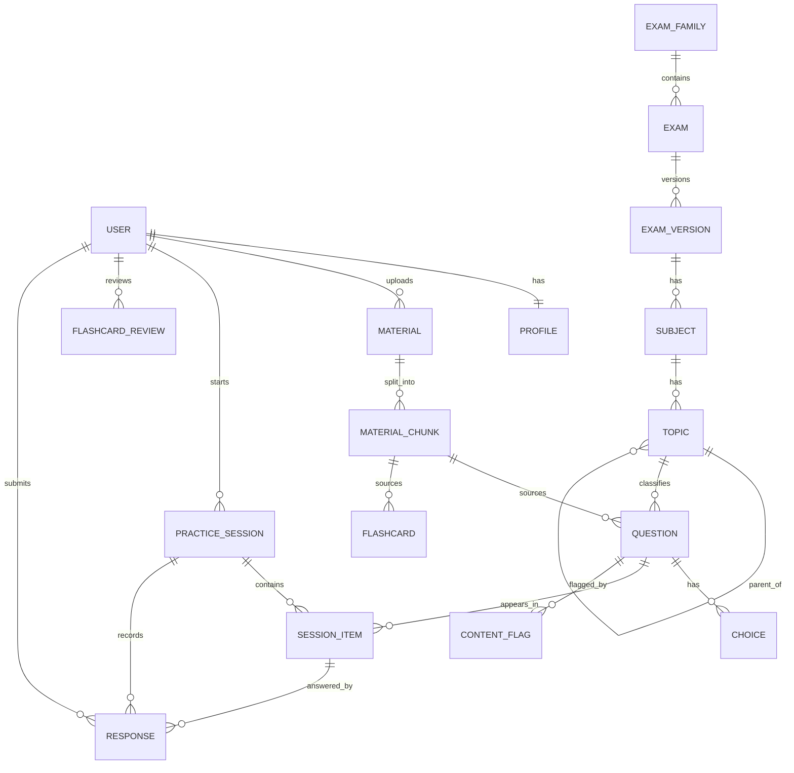

# Database Design

**Status:** Proposed — requires approval
**Owner:** Backend
**Last updated:** 2026-11-06

## 1. Principles

- PostgreSQL is the source of truth.
- UUID primary keys for domain entities; sequential integers are not exposed.
- `created_at` and `updated_at` on all domain tables (UTC).
- Soft delete only where recovery is a real requirement; otherwise hard delete
  with cascading owned rows.
- Reference data uses `PROTECT`; owned children use `CASCADE`.
- Store source/provenance for all AI-generated content.
- No user document bytes in the database.
- Embeddings use `pgvector` when RAG is enabled.

## 2. Entity relationship diagram (MVP)

## 3. Core tables

### `accounts_user`

| Column | Type | Notes |
| --- | --- | --- |
| `id` | uuid PK | |
| `email` | citext unique | case-insensitive login |
| `password` | varchar | Django hash |
| `display_name` | varchar(80) | |
| `is_active` | bool | |
| `is_staff` | bool | admin access |
| `email_verified_at` | timestamptz null | |
| `last_login_at` | timestamptz null | |
| `created_at`, `updated_at` | timestamptz | |

### `accounts_profile`

| Column | Type | Notes |
| --- | --- | --- |
| `user_id` | uuid PK/FK | one-to-one |
| `target_exam_id` | uuid null FK | `catalog_exam` |
| `timezone` | varchar(64) | default `Asia/Manila` |
| `study_preference` | jsonb | later use; keep empty initially |
| `created_at`, `updated_at` | timestamptz | |

### `catalog_exam_family`

`id`, `slug` (unique), `name`, `description`, `created_at`, `updated_at`.

### `catalog_exam`

`id`, `family_id` FK, `slug`, `name`, `level` (`professional`,
`subprofessional`), `is_active`.

### `catalog_exam_version`

| Column | Type | Notes |
| --- | --- | --- |
| `id` | uuid PK | |
| `exam_id` | uuid FK | |
| `label` | varchar | e.g. "2027 bulletin" |
| `source_url` | text | official CSC announcement |
| `published_at` | date | source date |
| `item_count` | int null | |
| `time_limit_seconds` | int null | |
| `passing_rate` | numeric(5,2) null | |
| `is_active` | bool | |

Practice content and attempts reference an exam version so bulletin changes do
not rewrite history.

### `catalog_subject`

`id`, `exam_version_id` FK, `slug`, `name`, `display_order`.

### `catalog_topic`

`id`, `subject_id` FK, `parent_id` nullable self-FK, `slug`, `name`,
`display_order`, `description`.

Unique: `(subject_id, parent_id, slug)`.

### `materials_material`

| Column | Type | Notes |
| --- | --- | --- |
| `id` | uuid PK | |
| `owner_id` | uuid FK | |
| `title` | varchar(200) | user-editable |
| `original_filename` | varchar(255) | sanitized for display |
| `content_type` | varchar(100) | declared |
| `detected_type` | varchar(100) | from magic bytes |
| `size_bytes` | bigint | |
| `checksum_sha256` | char(64) | dedupe/integrity |
| `object_key` | text | private storage key |
| `status` | varchar | `pending_upload`, `uploaded`, `processing`, `ready`, `failed`, `deleted` |
| `error_code` | varchar null | |
| `page_count` | int null | |
| `created_at`, `updated_at` | timestamptz | |

Indexes: `(owner_id, created_at desc)`, `(status)`, `(checksum_sha256)`.

### `materials_material_chunk`

| Column | Type | Notes |
| --- | --- | --- |
| `id` | uuid PK | |
| `material_id` | uuid FK | cascade |
| `ordinal` | int | chunk order |
| `text` | text | extracted |
| `token_count` | int null | |
| `page_start`, `page_end` | int null | citation |
| `embedding` | vector(N) null | dimension fixed per model |
| `embedding_model` | varchar | |
| `created_at` | timestamptz | |

Unique: `(material_id, ordinal)`. Index: HNSW/IVFFlat on `embedding` when used.

### `questions_question`

| Column | Type | Notes |
| --- | --- | --- |
| `id` | uuid PK | |
| `topic_id` | uuid FK | |
| `source_material_id` | uuid null FK | `SET_NULL` |
| `source_chunk_id` | uuid null FK | `SET_NULL` |
| `stem` | text | |
| `explanation` | text | |
| `difficulty` | smallint | 1–5 |
| `status` | varchar | `draft`, `in_review`, `approved`, `retired` |
| `origin` | varchar | `human`, `ai_assisted`, `ai_generated` |
| `generated_by_user_id` | uuid null FK | private generated items |
| `ai_generation_id` | uuid null FK | provenance |
| `created_at`, `updated_at` | timestamptz | |

Indexes: `(topic_id, status)`, `(status, difficulty)`, `(source_material_id)`.

### `questions_choice`

`id`, `question_id` FK, `text`, `is_correct`, `rationale` (why wrong/right),
`display_order`.

Constraint: exactly one correct choice per question, enforced in the service and
a database partial unique index.

### `questions_flashcard`

`id`, `topic_id`, `source_material_id`, `source_chunk_id`, `front`, `back`,
`status`, `origin`, `generated_by_user_id`, timestamps.

### `practice_practice_session`

| Column | Type | Notes |
| --- | --- | --- |
| `id` | uuid PK | |
| `user_id` | uuid FK | |
| `exam_version_id` | uuid FK | |
| `mode` | varchar | `untimed`, `timed` |
| `status` | varchar | `active`, `submitted`, `expired`, `abandoned` |
| `time_limit_seconds` | int null | snapshot |
| `started_at` | timestamptz | |
| `expires_at` | timestamptz null | |
| `submitted_at` | timestamptz null | |
| `score_correct` | int null | |
| `score_total` | int null | |

Indexes: `(user_id, started_at desc)`, `(status, expires_at)`.

### `practice_session_item`

`id`, `session_id` FK, `question_id` FK, `display_order`, `points`.
Unique: `(session_id, question_id)`, `(session_id, display_order)`.

The item set is snapshotted so later question edits do not change history.

### `practice_response`

| Column | Type | Notes |
| --- | --- | --- |
| `id` | uuid PK | |
| `session_id` | uuid FK | |
| `session_item_id` | uuid FK | |
| `selected_choice_id` | uuid null FK | |
| `is_correct` | bool null | computed on submit |
| `answered_at` | timestamptz | |
| `time_spent_seconds` | int null | client-reported, server-clamped |

Unique: `(session_item_id)` — one response per item; upsert on change before
submit.

### `analytics_topic_stat`

Materialized or incrementally updated aggregate:

`user_id`, `topic_id`, `attempts`, `correct`, `last_practiced_at`, `updated_at`.
Unique: `(user_id, topic_id)`.

This is a cache of derived data; the source of truth remains responses.

### `ai_generation`

| Column | Type | Notes |
| --- | --- | --- |
| `id` | uuid PK | |
| `user_id` | uuid null FK | |
| `kind` | varchar | summary, flashcards, questions, embedding |
| `provider` | varchar | |
| `model` | varchar | |
| `prompt_version` | varchar | |
| `input_hash` | char(64) | cache/idempotency |
| `status` | varchar | queued, running, succeeded, failed, rejected |
| `input_tokens`, `output_tokens` | int null | |
| `cost_usd` | numeric(10,6) null | |
| `error_code` | varchar null | |
| `created_at`, `completed_at` | timestamptz | |

Indexes: `(user_id, created_at desc)`, `(status)`, `(input_hash, prompt_version)`.

### `core_content_flag`

`id`, `reporter_id`, `question_id` / `flashcard_id` nullable, `reason`,
`comment`, `status` (`open`, `resolved`, `dismissed`), `resolution_note`,
timestamps.

### `core_audit_event`

`id`, `actor_id`, `action`, `object_type`, `object_id`, `metadata` jsonb,
`created_at`. Append-only.

## 4. Indexing guidance

- Index every foreign key used in filters.
- Composite indexes follow real query order: `(user_id, created_at desc)`.
- Avoid low-cardinality single-column indexes (`status` alone) unless combined.
- Use partial indexes for hot subsets (`WHERE status = 'approved'`).
- Revisit indexes with query statistics after beta; do not speculate.

## 5. Data lifecycle

| Data | Retention | Deletion |
| --- | --- | --- |
| Account | Until deletion request | Hard delete after grace period |
| Uploaded material | Until user deletes or account deletion | Object + chunks + derived items |
| Practice sessions/responses | Account lifetime unless policy says otherwise | Cascade on account delete |
| AI generation metadata | 12 months minimum for cost/audit | Anonymize user link |
| Audit events | 12 months | Append-only; legal hold overrides |
| Backups | 30 days | Provider lifecycle |

Retention periods require privacy/legal approval.

## 6. Migration rules

- Additive changes first; backfill in a separate migration.
- Add nullable columns before `NOT NULL`.
- Create indexes concurrently on large tables (`AddIndexConcurrently`).
- Never rename a table/column without a compatibility plan.
- Test forward and backward paths where reversible.
- Destructive changes need approval and a backup.

## 7. Open decisions

1. Confirm `pgvector` and embedding dimension.
2. Confirm retention periods.
3. Decide whether analytics aggregates are materialized views or incremental
   rows.
4. Decide whether exam versions are immutable snapshots (recommended).
5. Decide if user-generated AI items are stored separately from the shared pool.
6. Confirm `citext` vs. a normalized lower-case email column.
