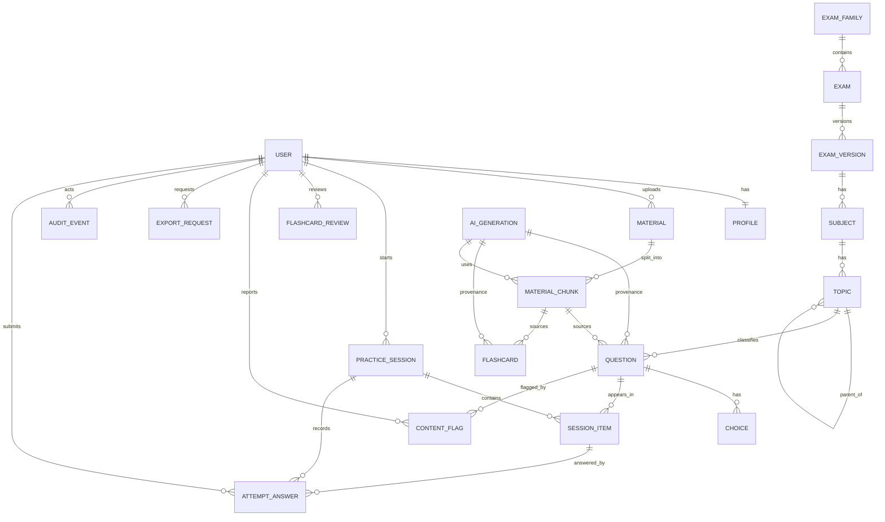

# Database Design

**Status:** Approved
**Owner:** Backend
**Last updated:** 2026-11-07
**Approved by:** Repository owner
**Approved on:** 2026-11-07

**Gaps documented (additive columns per SPEC-0003 §7):** `questions_question` needs `author_id` (FK User) and `provenance` text fields — both are not in the initial schema but are additive migrations needed for approved features.
**Owner:** Backend
**Last updated:** 2026-11-07

> **Canonical source** for ERD, fields, constraints, indexes, ownership, and
> migration rules. Other documents (MVP Data & API, specs) reference this file.

## 1. Principles

- PostgreSQL is the source of truth.
- UUID primary keys for domain entities; sequential integers are not exposed.
- `created_at` and `updated_at` on all domain tables (UTC).
- Soft delete only where recovery is a real requirement; otherwise hard delete
  with cascading owned rows.
- Reference data uses `PROTECT`; owned children use `CASCADE`.
- Store source/provenance for all AI-generated content.
- No user document bytes in the database.
- Embeddings use `pgvector` when RAG is enabled (beta).
- All indexes, constraints, and lifecycle rules are documented here.

## 2. Entity relationship diagram (MVP + beta)

## 3. Core tables — Accounts

### `accounts_user`

| Column | Type | Notes |
| --- | --- | --- |
| `id` | uuid PK | |
| `email` | citext UNIQUE | case-insensitive login |
| `password` | varchar | Django hash |
| `display_name` | varchar(80) | |
| `is_active` | bool | default true |
| `is_staff` | bool | admin access |
| `email_verified_at` | timestamptz NULL | |
| `last_login_at` | timestamptz NULL | |
| `created_at`, `updated_at` | timestamptz | |

### `accounts_profile`

| Column | Type | Notes |
| --- | --- | --- |
| `user_id` | uuid PK/FK | one-to-one, cascade on user delete |
| `target_exam_id` | uuid FK | `catalog_exam` |
| `timezone` | varchar(64) | default `Asia/Manila` |
| `study_preference` | jsonb | `{mode, size}` defaults |
| `created_at`, `updated_at` | timestamptz | |

**KAB-101 temporary deviation (resolved in KAB-102):** `accounts_profile.target_exam`
was a validated `varchar` (`professional` / `subprofessional`) until
`catalog_exam` existed. KAB-102 replaces it with the FK above and backfills
existing slugs to the seeded `cse-professional` / `cse-subprofessional` rows.
`display_name` stays on `accounts_user` as specified.

## 4. Core tables — Catalogue

### `catalog_exam_family`

`id`, `slug` (unique), `name`, `description`, `created_at`, `updated_at`.

### `catalog_exam`

`id`, `family_id` FK, `slug`, `name`, `level` (`professional`, `subprofessional`), `is_active`.

### `catalog_exam_version`

| Column | Type | Notes |
| --- | --- | --- |
| `id` | uuid PK | |
| `exam_id` | uuid FK | |
| `slug` | varchar | stable identifier, e.g. `2027-bulletin`; unique per exam |
| `label` | varchar | human label, e.g. "14 March 2027 CSE-PPT" |
| `source_url` | text | official CSC announcement |
| `published_at` | date | source date |
| `accessed_at` | date NULL | when the source was verified |
| `item_count` | int NULL | null while unverified |
| `time_limit_seconds` | int NULL | null while unverified |
| `passing_rate` | numeric(5,2) NULL | |
| `is_active` | bool | |

Practice content and attempts reference an exam version so bulletin changes do
not rewrite history.

### `catalog_subject`

`id`, `exam_version_id` FK, `slug`, `name`, `display_order`.

### `catalog_topic`

`id`, `subject_id` FK, `parent_id` nullable self-FK, `slug`, `name`,
`display_order`, `description`.

Unique: `(subject_id, parent_id, slug)`.

## 5. Core tables — Questions (MVP)

### `questions_question`

| Column | Type | Notes |
| --- | --- | --- |
| `id` | uuid PK | |
| `topic_id` | uuid FK | `PROTECT` |
| `source_material_id` | uuid NULL FK | `SET_NULL` (beta) |
| `source_chunk_id` | uuid NULL FK | `SET_NULL` (beta) |
| `stem` | text | |
| `explanation` | text | required if published |
| `difficulty` | smallint | 1–5 |
| `status` | varchar | `draft`, `in_review`, `published`, `retired` |
| `origin` | varchar | `human`, `ai_assisted`, `ai_generated` |
| `generated_by_user_id` | uuid NULL FK | private generated items |
| `ai_generation_id` | uuid NULL FK | provenance |
| `created_at`, `updated_at` | timestamptz | |

Indexes: `(topic_id, status)`, `(status, difficulty)`, `(source_material_id)`.

### `questions_choice`

`id`, `question_id` FK, `text`, `is_correct`, `rationale` (why wrong/right),
`display_order`.

Constraint: exactly one correct choice per question, enforced in the service and
a database partial unique index.

### `questions_content_flag`

`id`, `reporter_id` FK (nullable), `question_id` FK, `reason`, `comment`,
`status` (`open`, `resolved`, `dismissed`), `resolution_note`,
`resolved_by` FK, `resolved_at`, `created_at`, `updated_at`.

Unique: one open flag per `(reporter_id, question_id)`.

## 6. Core tables — Practice (MVP)

### `practice_practice_session`

| Column | Type | Notes |
| --- | --- | --- |
| `id` | uuid PK | |
| `user_id` | uuid FK | `CASCADE` on user delete |
| `exam_version_id` | uuid FK | `PROTECT` |
| `mode` | varchar | `untimed`, `timed` |
| `status` | varchar | `in_progress`, `submitted`, `expired`, `abandoned` |
| `time_limit_seconds` | int NULL | snapshot |
| `started_at` | timestamptz | |
| `expires_at` | timestamptz NULL | timed only |
| `submitted_at` | timestamptz NULL | |
| `score_correct` | int NULL | |
| `score_total` | int NULL | |

Indexes: `(user_id, started_at desc)`, `(status, expires_at)`.

### `practice_session_item`

| Column | Type | Notes |
| --- | --- | --- |
| `id` | uuid PK | |
| `session_id` | uuid FK | cascade |
| `question_id` | uuid FK | `PROTECT` (live question for reporting) |
| `display_order` | int | |
| `snapshot_stem` | text | **snapshot per ADR-0007** |
| `snapshot_options` | jsonb | **snapshot**: `[{id, text, is_correct}]` |
| `snapshot_explanation` | text | **snapshot** |
| `snapshot_provenance` | text | **snapshot** |
| `snapshot_difficulty` | smallint | **snapshot** |
| `created_at` | timestamptz | |

Unique: `(session_id, display_order)`, `(session_id, question_id)`.

### `practice_attempt_answer`

| Column | Type | Notes |
| --- | --- | --- |
| `id` | uuid PK | |
| `session_id` | uuid FK | |
| `session_item_id` | uuid FK | unique |
| `selected_choice_id` | uuid NULL FK | |
| `is_correct` | bool NULL | computed on submit |
| `answered_at` | timestamptz | |
| `time_spent_seconds` | int NULL | client-reported, server-clamped |

Unique: `(session_item_id)` — one response per item; upsert on change before
submit.

## 7. Core tables — Analytics

### `analytics_topic_stat`

Materialized or incrementally updated aggregate:

`user_id`, `topic_id`, `attempts`, `correct`, `last_practiced_at`, `updated_at`.

Unique: `(user_id, topic_id)`.

This is a cache of derived data; the source of truth remains responses.

## 8. Beta tables — Materials

### `materials_material`

| Column | Type | Notes |
| --- | --- | --- |
| `id` | uuid PK | |
| `owner_id` | uuid FK | `CASCADE` |
| `title` | varchar(200) | user-editable |
| `original_filename` | varchar(255) | sanitized for display |
| `content_type` | varchar(100) | declared |
| `detected_type` | varchar(100) | from magic bytes |
| `size_bytes` | bigint | |
| `checksum_sha256` | char(64) | dedupe/integrity |
| `object_key` | text | private storage key |
| `status` | varchar | `pending_upload`, `uploaded`, `processing`, `ready`, `failed`, `deleted` |
| `error_code` | varchar NULL | |
| `page_count` | int NULL | |
| `created_at`, `updated_at` | timestamptz | |

Indexes: `(owner_id, created_at desc)`, `(status)`, `(checksum_sha256)`.

### `materials_material_chunk`

| Column | Type | Notes |
| --- | --- | --- |
| `id` | uuid PK | |
| `material_id` | uuid FK | cascade |
| `ordinal` | int | chunk order |
| `text` | text | extracted |
| `token_count` | int NULL | |
| `page_start`, `page_end` | int NULL | citation |
| `embedding` | vector(N) NULL | dimension fixed per model |
| `embedding_model` | varchar | |
| `created_at` | timestamptz | |

Unique: `(material_id, ordinal)`. Index: HNSW/IVFFlat on `embedding` when used.

## 9. Beta tables — AI & Flashcards

### `questions_flashcard`

`id`, `topic_id`, `source_material_id`, `source_chunk_id`, `front`, `back`,
`status` (`draft`, `published`, `retired`), `origin`, `generated_by_user_id`,
timestamps.

### `ai_generation`

| Column | Type | Notes |
| --- | --- | --- |
| `id` | uuid PK | |
| `user_id` | uuid NULL FK | |
| `kind` | varchar | summary, flashcards, questions, embedding |
| `provider` | varchar | |
| `model` | varchar | |
| `prompt_version` | varchar | |
| `input_hash` | char(64) | cache/idempotency |
| `status` | varchar | queued, running, succeeded, failed, rejected |
| `input_tokens`, `output_tokens` | int NULL | |
| `cost_usd` | numeric(10,6) NULL | |
| `error_code` | varchar NULL | |
| `created_at`, `completed_at` | timestamptz | |

Indexes: `(user_id, created_at desc)`, `(status)`, `(input_hash, prompt_version)`.

## 10. Core tables — System

### `core_audit_event`

`id`, `actor_id` FK (SET_NULL), `action` varchar, `object_type` varchar,
`object_id` uuid NULL, `metadata` jsonb, `created_at`. Append-only.

### `core_export_request`

| Column | Type | Notes |
| --- | --- | --- |
| `id` | uuid PK | |
| `user_id` | uuid FK | |
| `status` | varchar | pending, ready, expired |
| `requested_at` | timestamptz | |
| `completed_at` | timestamptz NULL | |
| `file_path` | text NULL | |

## 11. Indexing guidance

- Index every foreign key used in filters.
- Composite indexes follow real query order: `(user_id, created_at desc)`.
- Avoid low-cardinality single-column indexes (`status` alone) unless combined.
- Use partial indexes for hot subsets (`WHERE status = 'published'`).
- Revisit indexes with query statistics after beta; do not speculate.

## 12. Data lifecycle

| Data | Retention | Deletion |
| --- | --- | --- |
| Account | Until deletion request | Hard delete after grace period |
| Uploaded material | Until user deletes or account deletion | Object + chunks + derived items |
| Practice sessions/responses | Account lifetime unless policy says otherwise | Cascade on account delete |
| AI generation metadata | 12 months minimum for cost/audit | Anonymize user link |
| Audit events | 12 months | Append-only; legal hold overrides |
| Backups | 30 days | Provider lifecycle |

Retention periods require privacy/legal approval.

## 13. Migration rules

- Additive changes first; backfill in a separate migration.
- Add nullable columns before `NOT NULL`.
- Create indexes concurrently on large tables (`AddIndexConcurrently`).
- Never rename a table/column without a compatibility plan.
- Test forward and backward paths where reversible.
- Destructive changes need approval and a backup.

## 14. Open decisions

Resolved as implementation defaults (revisit only if a concrete issue appears):

1. `pgvector` and embedding dimension — deferred to beta; not used in MVP.
2. Retention periods — 30-day backups, 12-month AI metadata/audit; confirm with
   privacy review before public launch.
3. Analytics aggregates — incremental rows (`analytics_topic_stat`) updated on
   submit, not materialized views.
4. Exam versions are immutable snapshots — accepted.
5. User-generated AI items stay private (`generated_by_user_id`) until reviewed;
   reviewed items enter the shared pool — accepted.
6. Email stored via `citext` with application-level lower-case normalization —
   accepted.

## 15. Approval

**Approved 2026-11-07** as the implementation baseline. Documented additive gaps:
`questions_question.author_id` and `questions_question.provenance` (required by
SPEC-0003 §7) are added via the first questions migration.