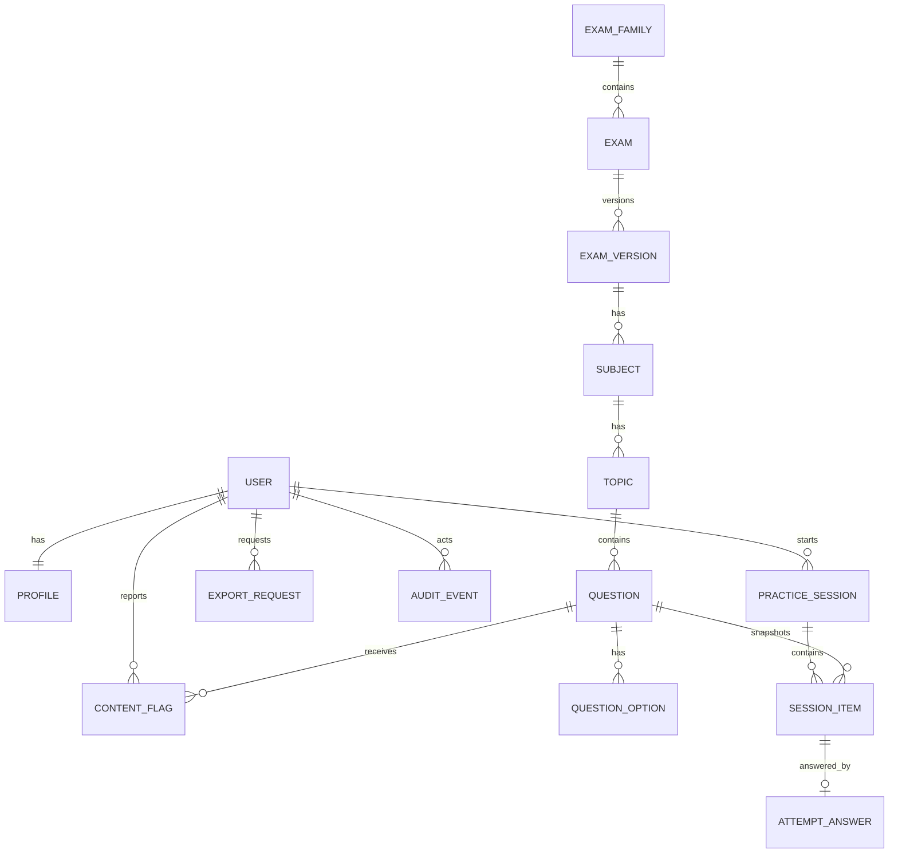

# MVP Data and API Requirements

**Status:** Proposed — for the approved MVP scope
**Owner:** Backend / Architecture
**Last updated:** 2026-11-06

Technical requirements for the MVP (increment 1) and the deltas the beta adds.
Companion: [database-design.md](database-design.md) (direction),
[system-architecture.md](system-architecture.md) (boundaries),
[mvp-scope.md](../product/mvp-scope.md) (features), and
[ADR-0007](decisions/0007-practice-attempt-snapshot.md) (snapshot decision).

This document does not approve a hosting provider, a queue, or a new module.

## 1. Scope

In scope: accounts, profile, catalogue, question bank, practice, results,
analytics, flags, and account deletion/export.

Out of scope: materials, embeddings, AI, flashcards (beta), payments, social
features, proctoring.

## 2. Entities

| Entity | Key fields | Notes |
| --- | --- | --- |
| `User` | email, password hash, is_active, is_staff, timestamps | Django auth user; email is the identifier |
| `Profile` | user (1:1), display_name, target_exam, preference | Created on registration |
| `ExamFamily` | name, slug | `Civil Service` for the MVP |
| `Exam` | family, name, level, slug | CSE Professional, CSE Subprofessional |
| `ExamVersion` | exam, effective_date, source_url, published_on, accessed_on, passing_grade | One row for the 14 March 2027 announcement |
| `Subject` | version, name, language, display_order | Version-scoped |
| `Topic` | subject, name, parent (nullable), display_order | Version-scoped; parent supports grouping |
| `Question` | topic, stem, difficulty, explanation, provenance, status, author, reviewer, timestamps | Never hard-deleted; `retired` instead |
| `QuestionOption` | question, text, is_correct, display_order | Exactly one correct |
| `PracticeSession` | user, exam_version, mode, status, item_count, started_at, deadline_at, submitted_at, score fields | `untimed` or `timed` |
| `SessionItem` | session, position, question, snapshot fields | Snapshot per ADR-0007 |
| `AttemptAnswer` | session_item (1:1), selected option snapshot, answered_at, is_correct | Saved as the learner answers |
| `ContentFlag` | question, user (nullable), reason, note, status, resolution, resolved_by, timestamps | One open flag per user and question |
| `AuditEvent` | actor, action, object type, object id, summary, created_at | Append-only |
| `ExportRequest` | user, status, requested_at, completed_at | Manual fulfilment at alpha |

`SessionItem` snapshot fields: stem, ordered options, correct option, explanation,
provenance, difficulty. The live `question` link is retained for reporting only.

## 3. Constraints and indexes

- `QuestionOption`: exactly one `is_correct` per question, enforced in the service
  and by a conditional unique constraint.
- `SessionItem`: unique `(session, position)`; `AttemptAnswer` unique per session
  item.
- `ContentFlag`: unique open flag per `(user, question)`.
- `PracticeSession`: a submitted session cannot return to `in_progress`.
- Indexes: `Question(topic, status)`, `PracticeSession(user, submitted_at)`,
  `SessionItem(session)`, `ContentFlag(status, created_at)`,
  `AuditEvent(object_type, object_id)`.
- All domain tables carry UUID primary keys and `created_at` / `updated_at`.

## 4. Deletion and retention

| Action | Effect |
| --- | --- |
| User deletes account | Profile and export requests deleted; sessions and answers deleted; flags keep the question and reason category but `user` becomes null and the free-text note is cleared; audit events keep the actor id only |
| Curator retires a question | Item leaves new sets; session snapshots and results unchanged |
| Exam version is replaced | Old version and its content retained; new version added |
| Subject, topic, or version with questions | Delete is blocked (`PROTECT`); retire or archive instead |
| Practice session | Never deleted before account deletion |

Retention: no purge of practice history while the account exists. Backups follow
the production retention policy, set at launch hardening.

## 5. API outline

Base path `/api/v1/`. Session cookie authentication with CSRF protection through
the same-origin proxy (ADR-0004). JSON only, snake_case, UUID identifiers, ISO 8601
UTC timestamps, standard error envelope, pagination 20 default / 100 maximum.

### Accounts and profile

| Method | Path | Purpose |
| --- | --- | --- |
| POST | `/auth/register/` | Create account and session |
| POST | `/auth/login/` | Start session |
| POST | `/auth/logout/` | End session |
| POST | `/auth/password-reset/` | Request reset email, always the same response |
| POST | `/auth/password-reset/confirm/` | Consume single-use token, set password |
| GET | `/me/` | Profile and target exam |
| PATCH | `/me/` | Update display name, target exam, preference |
| DELETE | `/me/` | Delete account after password confirmation |
| POST | `/me/export/` | Request a data export |
| GET | `/me/export/{id}/` | Export status |

### Catalogue

| Method | Path | Purpose |
| --- | --- | --- |
| GET | `/exams/` | Exam families and exams |
| GET | `/exam-versions/{id}/subjects/` | Subjects for a version |
| GET | `/subjects/{id}/topics/` | Topics with the learner's accuracy and attempt count |
| GET | `/topics/{id}/` | Topic detail and weak-topic status |

### Practice

| Method | Path | Purpose |
| --- | --- | --- |
| POST | `/practice-sessions/` | Start a session (`mode`, `topic`, `size`) |
| GET | `/practice-sessions/{id}/` | Session state, items, saved answers, remaining time |
| PUT | `/practice-sessions/{id}/answers/{position}/` | Save or change one answer |
| POST | `/practice-sessions/{id}/submit/` | Submit; idempotent, returns the result |
| GET | `/practice-sessions/{id}/results/` | Score, correctness, explanations, provenance |
| GET | `/practice-sessions/` | Paginated history |

### Analytics

| Method | Path | Purpose |
| --- | --- | --- |
| GET | `/analytics/summary/` | Accuracy by subject |
| GET | `/analytics/topics/` | Accuracy and weak-topic status by topic |

### Flags

| Method | Path | Purpose |
| --- | --- | --- |
| POST | `/questions/{id}/flags/` | Report an item (reason category, optional note) |

### Administration

Django admin for the MVP, restricted to staff, with explicit review actions and
an audit trail. No public admin API is built.

## 6. Behavioural requirements

- **Authorization:** every query filters by the authenticated user for owned rows;
  staff access is explicit and audited (`NFR-SEC-02`).
- **Answer saves:** small, idempotent, and safe to retry. A save after the deadline
  returns `409` with `session_expired`.
- **Submit:** if the session is already submitted, return the existing result with
  `200` rather than an error (`NFR-REL-02`).
- **Timed sessions:** the deadline is stored server-side; the client countdown is
  display only.
- **Scoring:** computed once at submission and stored; results never recompute
  from live questions.
- **Rate limits:** authentication endpoints in the MVP; AI and upload endpoints
  when those features ship.
- **Errors:** stable envelope with `code`, `message`, and `fields`; no stack
  traces or provider payloads.

## 7. Background processes

**MVP:** none required beyond email delivery. Password-reset email is sent during
the request with a short timeout and a generic user response; a delivery failure is
logged and the user is asked to retry. Analytics are computed on read from indexed
queries at MVP volume.

Redis and Celery are introduced with the first genuinely asynchronous feature
(material extraction in beta), as the existing architecture states.

**Beta:** extraction, embedding, and generation run in workers with bounded retries
and a dead-letter state; job status is visible to the owner; quotas and spend caps
are enforced in the queue path, not the HTTP handler.

## 8. Gaps against the current architecture documents

| Gap | Resolution |
| --- | --- |
| `SessionItem` stored only `question_id` | Resolved by [ADR-0007](decisions/0007-practice-attempt-snapshot.md) |
| Exam-version content reuse | One version in the MVP. A new announcement creates a new version and its own subject/topic rows; cross-version content reuse needs an ADR before a second version is seeded |
| Celery assumed for all async work | Not required for the MVP; first used in beta |
| Transactional email provider | Required for password reset; provider not selected, so the environment variable is not yet added |
| Session auth | Assumes ADR-0004 is approved; still `Proposed` |
| Admin surface | Django admin chosen for the MVP to avoid building a second UI; revisit if curator volume grows |

## 9. Decisions taken

| Question | Decision |
| --- | --- |
| Export format | JSON archive plus CSV |
| History filtering | Pagination only in the MVP |
| Public catalogue for SEO | No; authenticated only |
| Backup retention for deleted accounts | Set at launch hardening with the hosting decision |

Remaining unknown: the alpha backup retention promise depends on the hosting
provider, which is not selected.
