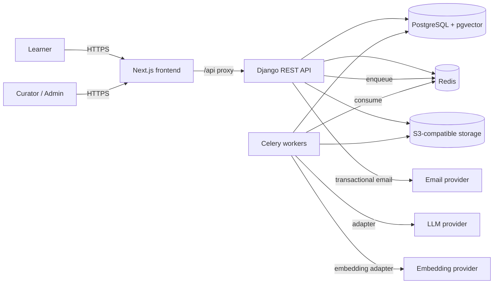
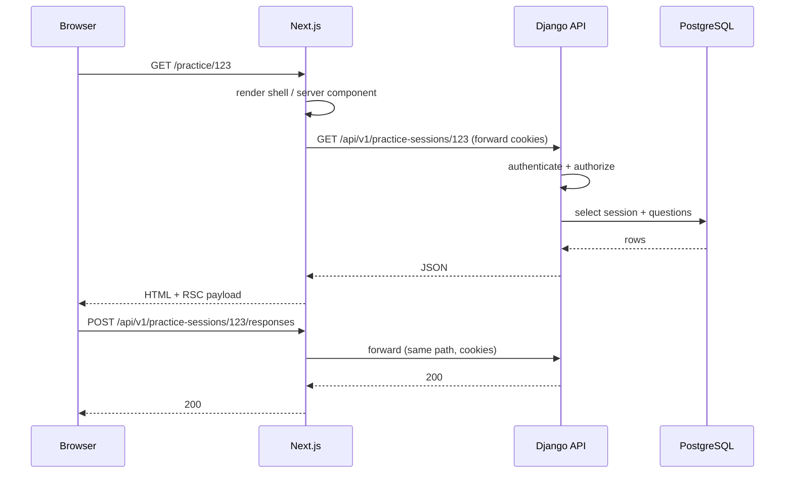
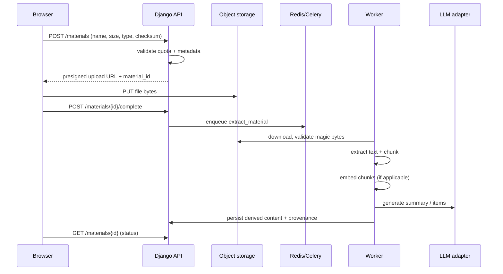

# System Architecture

**Status:** Proposed — requires approval
**Owner:** Engineering
**Last updated:** 2026-11-06

## 1. Scope

This document describes the initial architecture for Kabisado: a modular
monolith with a Next.js frontend, a Django REST API, PostgreSQL, asynchronous
workers, object storage, and a provider-independent AI layer.

It intentionally does **not** select a production hosting provider. Deployment
topology is described in terms of capabilities, not vendors.

## 2. Architectural principles

1. **Modular monolith first.** One deployable API and one worker process. Split
   only when a measured constraint justifies the operational cost.
2. **Explicit boundaries.** Each Django app owns its models and exposes services.
   Cross-module access goes through a service or selector, not another app's
   internals.
3. **Async by default for slow work.** Extraction, embedding, and model calls
   never block an HTTP request.
4. **Provider independence.** AI and storage are accessed through interfaces.
5. **Secure by default.** Private storage, object-level authorization, least
   privilege, no secrets in code.
6. **Boring technology.** Prefer proven primitives over novel infrastructure.

## 3. System context



External services are replaceable. The AI provider is selected at configuration
time; only the adapter implementation knows the vendor.

## 4. Containers

| Container | Responsibility | Scales on |
| --- | --- | --- |
| `frontend` | UI, routing, SSR, BFF proxy to API | Request volume / regions |
| `api` | Auth, domain logic, REST, presigned URLs | CPU / request rate |
| `worker` | Extraction, embedding, AI generation, cleanup | Queue depth |
| `scheduler` | Periodic jobs (cleanup, retries, quotas) | One replica |
| `postgres` | Source of truth + vectors | Vertical first, read replicas later |
| `redis` | Cache, Celery broker, rate limits | Vertical first |
| `object storage` | Private uploads and derived artifacts | Provider-managed |

The API and worker run the same codebase with different entry points.

## 5. Backend modules

```text
backend/
├── config/                 # settings, urls, wsgi, asgi, celery
└── apps/
    ├── core/               # health, shared base models, error handling, pagination
    ├── accounts/           # users, profiles, auth, sessions, deletion
    ├── catalog/            # exam families, exams, versions, subjects, topics
    ├── materials/          # uploads, storage, extraction, chunks, provenance
    ├── questions/          # questions, choices, flashcards, review queue
    ├── practice/           # sessions, attempts, responses, scoring
    ├── analytics/          # aggregates, weak topics, history
    └── ai/                 # provider adapters, prompts, RAG, quotas, generation
```

| Module | Owns | May depend on |
| --- | --- | --- |
| `core` | Base model, health, shared utilities | Nothing domain-specific |
| `accounts` | `User`, `Profile` | `core` |
| `catalog` | Exam taxonomy | `core` |
| `materials` | `Material`, `MaterialChunk`, storage | `core`, `accounts` |
| `questions` | `Question`, `Choice`, `Flashcard` | `core`, `catalog`, `materials` |
| `practice` | `PracticeSession`, `Response` | `core`, `questions`, `accounts` |
| `analytics` | Read models and aggregates | `core`, `practice` |
| `ai` | Adapters, prompts, generation jobs | `core`, `materials`, `questions` |

Rules:

- `analytics` reads practice data through selectors; it does not write practice
  rows.
- `practice` can call `questions` services to select items; it does not import
  `questions.models` directly in views.
- `ai` is the only module that talks to model providers.
- `core` must not import domain modules.

## 6. Frontend / backend responsibilities

**Frontend owns**

- Presentation, routing, accessibility, client-side interaction state.
- Server-side rendering and caching of public/marketing pages.
- Same-origin `/api` proxy for browser requests.
- Optimistic UI where safe, with server reconciliation.
- No domain rules, scoring, or authorization decisions.

**Backend owns**

- Authentication and authorization.
- Validation at the trust boundary.
- Scoring, weak-topic rules, quotas, and content selection.
- Persistence and migrations.
- AI orchestration and provenance.
- Audit logs.

## 7. Request flow



The browser never needs a cross-origin API URL. This keeps session cookies
first-party and avoids CORS complexity. Large files bypass this path.

## 8. Upload and AI flow



Failure handling:

- Upload sessions expire; abandoned objects are deleted by a scheduled job.
- Extraction failures retry with backoff, then surface an actionable error.
- AI failures do not block reading the source material.
- Every job is idempotent by input hash and job ID.

## 9. Authentication and authorization (proposed)

- Django session authentication, with the Next.js same-origin proxy.
- CSRF protection enabled; the browser obtains a CSRF token from a dedicated
  endpoint and sends `X-CSRFToken` on unsafe requests.
- Session cookie: `HttpOnly`, `Secure` outside local, `SameSite=Lax`.
- Object-level permissions in the service layer, not only in views.
- Staff actions use Django admin initially, protected by staff flags and audit
  logging.
- No JWT in `localStorage`.

**Needs approval:** session auth vs. token auth. See
[ADR-0004](decisions/0004-authentication.md).

## 10. Data and storage

- PostgreSQL is the source of truth. `pgvector` stores embeddings when RAG is
  enabled.
- Uploaded originals are private objects; the database stores metadata and the
  object key, never the bytes.
- Derived text and chunks are stored in PostgreSQL for retrieval and provenance.
- Signed URLs are short-lived and scoped to one object.
- Backups: daily full + point-in-time recovery where the provider supports it.

## 11. Async processing

Celery with Redis as broker. Queues:

| Queue | Work | Concurrency |
| --- | --- | --- |
| `extraction` | download, validate, parse, chunk | CPU/memory bound |
| `embedding` | embed chunks in batches | network bound |
| `generation` | summaries, flashcards, questions | network bound, rate-limited |
| `maintenance` | cleanup, quota reset, retries | low |

Rules:

- No model call or PDF parse in a request handler.
- Jobs carry an idempotency key and record attempts.
- Long jobs report progress through a status field, not a held connection.
- A daily spend cap can pause `generation` without stopping practice.

## 12. Deployment topology (provider-neutral)

```text
Vercel (frontend)
   │  HTTPS
   ▼
API container ──► managed PostgreSQL
   │
   ├──► managed Redis ──► worker container(s)
   │                        └──► AI providers
   └──► S3-compatible bucket
```

- Frontend: Vercel, with the API proxy configured through rewrites.
- API/worker: any container host; provider not selected.
- Database/Redis/object storage: managed services preferred for a small team.
- Environments: local, test/CI, staging, production. Staging mirrors production
  topology at smaller scale.
- Production deployment requires manual approval (see `docs/engineering/ci-cd.md`).

## 13. Scalability

Initial target: thousands of registered users, hundreds of concurrent learners.
A single API instance, one worker, and a modest Postgres instance are sufficient.

Scale in this order:

1. Add API replicas behind a load balancer (stateless, sessions in DB/cache).
2. Increase worker concurrency or add workers per queue.
3. Add read replicas for analytics.
4. Partition large tables (responses, chunks) only when measured.
5. Move analytics to a separate store only if it competes with transactional load.

Do not introduce microservices, Kafka, or a separate vector database before
measurements justify them.

## 14. Failure modes

| Failure | Behaviour |
| --- | --- |
| AI provider down | Generation queued/retried; practice and review unaffected |
| Redis down | Async jobs pause; API returns 503 for enqueue-dependent actions |
| Object storage down | Uploads fail cleanly; existing metadata remains |
| Postgres down | API returns 503; frontend shows a service error |
| Worker crash | Job retried; idempotency prevents duplicates |
| Email provider down | Verification/reset queued and retried; account remains usable within limits |

## 15. Observability

- Structured JSON logs with request/job IDs.
- Metrics: request latency, error rate, queue depth, job duration, AI tokens,
  AI cost, upload failures.
- Traces for API → DB and worker → provider calls (sampled).
- Alerts: error rate, queue backlog, failed jobs, spend cap, disk/DB capacity.
- No document contents or PII in logs.

## 16. What adds operational complexity

| Component | Why it exists | Cost | Defer if |
| --- | --- | --- | --- |
| Celery + Redis | Slow extraction/AI must not block requests | Broker, worker, retries, monitoring | No async work yet |
| pgvector | Grounded retrieval and citations | Extension, index tuning | No RAG yet |
| S3-compatible storage | Large private files, presigned access | Bucket, lifecycle, signing | No uploads yet |
| Separate worker | Isolation from API latency | Another deployable | No async work yet |

Each is already in the approved direction. The first three are not wired until
their feature tickets land.

## 17. Open decisions

1. Approve session auth + same-origin proxy.
2. Approve presigned object storage.
3. Approve pgvector vs. an external vector store.
4. Approve the first AI provider(s) and data-processing terms.
5. Select production hosting.
6. Decide whether the API proxy is Vercel rewrites or a dedicated edge function.
