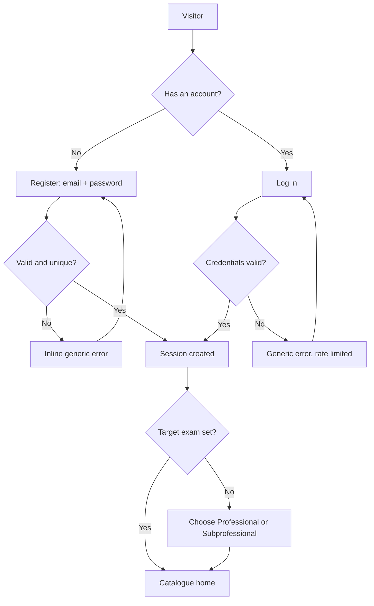
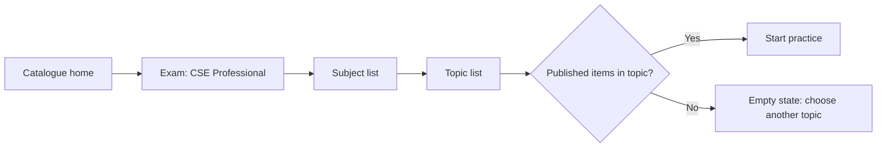
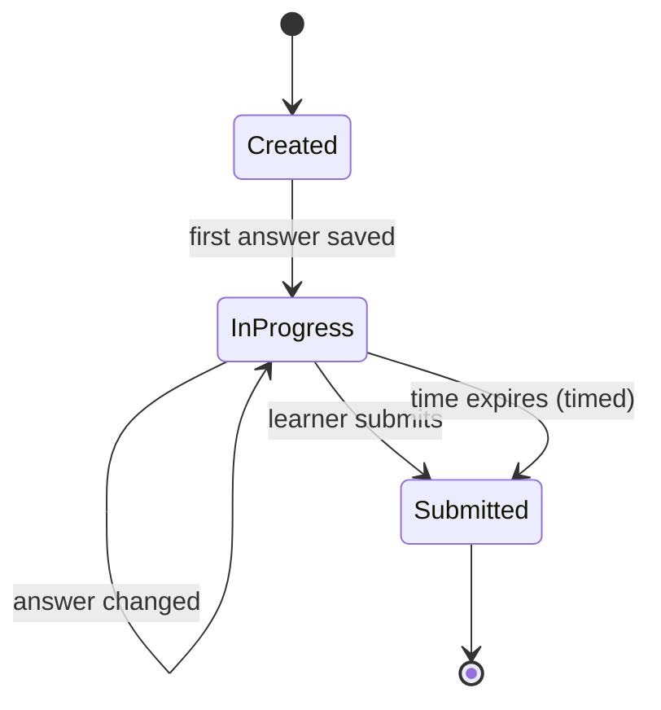
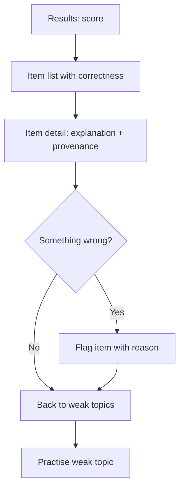
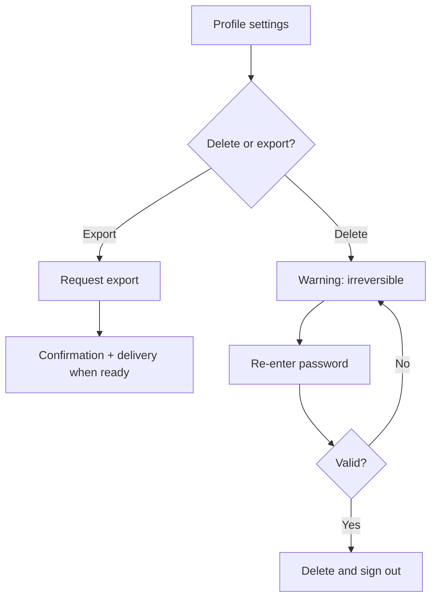
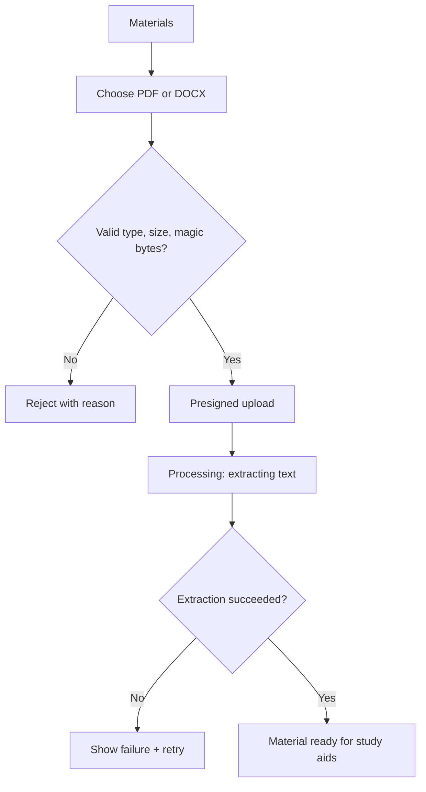
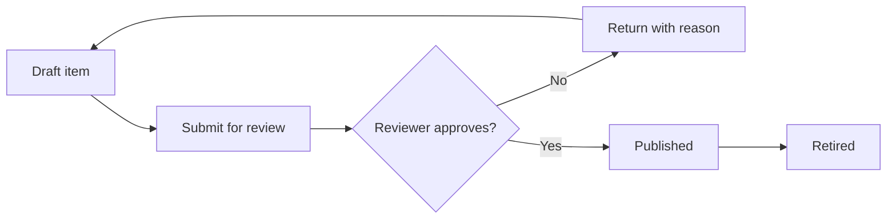

# User Flows

**Status:** Proposed — requires approval (Phase 2, Checkpoint 4)
**Owner:** Product
**Last updated:** 2026-11-06

Primary journeys for the MVP and the fast-follow beta, including error states and
edge cases. Feature IDs refer to [mvp-scope.md](mvp-scope.md); requirement IDs to
[product-requirements.md](product-requirements.md).

**Reading the status labels:** `MVP` = increment 1 (private alpha). `Beta` =
increment 2 (fast-follow). `Later` = post-MVP. Do not implement `Beta` flows
before their gates are approved.

## 1. Roles and permissions

| Role | Can | Cannot |
| --- | --- | --- |
| Anonymous | View marketing pages, register, log in, reset password | View any study data |
| Learner | Manage own profile, practise, view own results and analytics, flag items, delete own account | See other users' data, publish content, edit catalogue |
| Staff (curator) | Author drafts, review and publish others' drafts, retire items, resolve flags | Publish own items, manage accounts |
| Admin | Everything staff can do, plus suspend accounts and manage staff | Read user practice content beyond what moderation requires |

Rules:

- Every study route requires authentication; anonymous requests redirect to login
  with a return path.
- Authorization is object-level: a learner can only read and write rows they own
  (`NFR-SEC-02`).
- Staff never see a learner's practice answers or uploaded material except through
  a documented moderation action.

## 2. Global behaviours

| Situation | Behaviour |
| --- | --- |
| Session expires mid-task | Save current answer, redirect to login with return path, restore the attempt after sign-in |
| Network failure during an answer save | Keep the answer in the UI as unsent, retry with backoff, show a non-blocking "not saved" indicator |
| API 5xx | Show an error state with a retry action and a correlation ID; never lose a submitted attempt |
| 403 | Explain that the resource is not available to this account; do not reveal whether it exists |
| 404 | Not-found page with a link back to the catalogue |
| Rate limited | Show the wait time from `Retry-After`; keep the form state |
| Double action (double submit, double tap) | One server effect; the second request is idempotent |
| Multiple tabs | Server state wins; a stale tab shows a refresh prompt rather than overwriting newer answers |
| Long text (name, note, explanation) | Truncate in lists with full text on the detail view; never break layout at 360 px |
| Loading | Skeleton or spinner per panel; no full-page blank screen |
| Empty | Explain why it is empty and give one next action |

Every data view implements loading, empty, error, and unauthorized states
(`NFR-UX-02`).

## 3. Flow 1 — Register, sign in, recover access (MVP, F1)

**Steps**

1. Register with email and password, or log in.
2. On first sign-in, choose a target exam; this scopes the catalogue.
3. Land on the catalogue home with a single primary action: start practising.

**Error states**

| Condition | Expected behaviour |
| --- | --- |
| Email already registered | Generic "check your details" message; no confirmation that the email exists |
| Weak or breached password | Inline guidance on the rule that failed; do not echo the password |
| Too many attempts | Rate limit with a wait message; the form stays filled |
| Reset link expired or already used | Explain and offer a new reset request |
| Reset for an unknown email | Same confirmation as a known email; send nothing |

**Edge cases**

- Email case and whitespace are normalised before uniqueness checks.
- A reset invalidates existing sessions; the user signs in again.
- Onboarding can be skipped; the catalogue prompts for a target exam instead of
  guessing one.
- Registering while already signed in redirects to the catalogue.

## 4. Flow 2 — Choose exam, browse subjects and topics (MVP, F2, F3)

**Steps**

1. The catalogue shows the target exam's subjects in official order.
2. Selecting a subject lists its topics with the learner's accuracy and attempt
   count where available.
3. Selecting a topic offers practice (untimed or timed) and, when data exists, a
   shortcut to its weak-topic status.
4. Changing the target exam reloads the catalogue and keeps history.

**Error states**

| Condition | Expected behaviour |
| --- | --- |
| Topic has no published items | Empty state, no start button, suggest a sibling topic |
| Target exam has no content yet (Subprofessional at launch) | Show the catalogue as reference with a "practice content coming later" note; no dead start button |
| Catalogue data fails to load | Error state with retry; keep the selected exam |

**Edge cases**

- Subprofessional shows Clerical Ability and no Analytical Ability; the reverse
  applies to Professional.
- A subject with zero topics is not rendered.
- An exam-version change (new CSC announcement) shows the new version; past
  attempts stay on their original version.

## 5. Flow 3 — Practise and answer (MVP, F5, F6)

**Steps — untimed**

1. Choose subject/topic and set size (default 20).
2. Answer items in any order; answers are saved as they change.
3. Submit; unanswered items are counted wrong and listed as unanswered.
4. Results appear (Flow 4).

**Steps — timed**

1. Same start, plus a countdown from the server-recorded deadline.
2. The server rejects answers received after the deadline.
3. At expiry the attempt auto-submits, including unanswered items.

**Error states**

| Condition | Expected behaviour |
| --- | --- |
| Answer save fails | Keep the selection, show "not saved", retry; block submit until saved or explicitly confirmed |
| Submit fails | Keep the attempt open; retry is safe and idempotent |
| Submit arrives after the deadline | Score the answers received before the deadline; mark the rest unanswered |
| Attempt already submitted in another tab | Show the existing result instead of a second submission |
| Time expires while offline | The server deadline decides; on reconnect the attempt is submitted with the answers it received |

**Edge cases**

- A question retired after an attempt started stays in that attempt (snapshot
  recommended; final decision in Checkpoint 6).
- Changing the target exam mid-attempt does not change the attempt's items.
- Set size larger than available items: use all available items and say so.
- Zero published items: the start action is disabled with an explanation.
- A timed attempt resumed after expiry submits immediately with saved answers.
- Answers are not revealed before submission, in either mode.

## 6. Flow 4 — Results, explanations, and weak topics (MVP, F7, F9, F10)

**Steps**

1. Results show score, correct count, unanswered count, and time taken (timed).
2. Each item shows the chosen answer, the correct answer, the explanation, and
   provenance.
3. The score is labelled a practice estimate, never an official rating.
4. Weak topics are listed with the rule and attempt count, each linking to
   practice.
5. A learner can flag an item from the results view.

**Error states**

| Condition | Expected behaviour |
| --- | --- |
| Results request fails | Retry; the submission is already persisted |
| Explanation missing on a published item | Show the answer and a "content issue" note; this is a content defect to fix |
| Flag fails | Keep the reason text, retry, show failure |
| No weak topics | Encouraging empty state with a suggested next topic |

**Edge cases**

- Flagging the same item twice from the same user merges into one report.
- A flagged item stays visible to the learner; flagging does not hide content.
- Results are immutable after submission; a later content edit does not rewrite
  the historical score.
- A learner with five answers on one topic is not labelled weak until the
  three-answer minimum is met.

## 7. Flow 5 — Track progress (MVP, F8, F9)

**Steps**

1. Open progress from the catalogue or profile.
2. See accuracy by subject and topic, each with an attempt count.
3. See recent practice history, newest first, paginated.
4. Open weak topics and start targeted practice.

**Error states**

| Condition | Expected behaviour |
| --- | --- |
| No submitted attempts | Empty state explaining that progress appears after the first session |
| Analytics request fails | Retry; keep the last loaded values visible with a stale marker |
| One user requests another user's progress | 404 or 403, never data |

**Edge cases**

- Percentages are rounded consistently and always shown with counts.
- Topic rows with fewer than three attempts are shown without a weak label.
- History includes timed and untimed attempts with their mode.
- Deleting an account removes that history from all views.

## 8. Flow 6 — Delete account or export data (MVP, F11)

**Error states**

| Condition | Expected behaviour |
| --- | --- |
| Wrong password at deletion | Generic error, no deletion, rate limited |
| Export request fails | Keep the request visible with retry; no silent failure |
| Deletion fails part-way | Roll back or complete on retry; never leave a half-deleted account able to sign in |

**Edge cases**

- Deletion while a practice attempt is open discards the attempt.
- The email becomes reusable after deletion.
- Export includes profile, attempts, results, and flags; not other users' data.
- At alpha, export fulfilment may be manual; the UI must state the expected wait.

## 9. Flow 7 — Upload and study personal material (Beta, MAT)

**Gate:** storage provider selected, `KAB-005` threat model approved.

**Error states**

| Condition | Expected behaviour |
| --- | --- |
| Wrong file type or disguised extension | Reject before upload; explain accepted types |
| File too large | Reject with the limit |
| Upload interrupted | Resume or restart; no partial material record |
| Extraction fails or returns no text | Mark failed, show retry, suggest OCR is not supported |
| Scanned PDF | Flag as needing OCR; do not pretend extraction worked |

**Edge cases**

- Duplicate file (same checksum) reuses the existing material for that user.
- Deleting a material deletes its derived content.
- A material is never visible to another user, including staff, except through a
  documented moderation action.
- Upload is blocked until email verification (`AUTH-06`).

## 10. Flow 8 — AI study aids and flashcards (Beta, AI, QST-04)

**Gate:** provider decision (`KAB-003`), privacy review, review-capacity plan.

1. Choose a ready material or a catalogue topic.
2. Request a summary, flashcards, or generated practice items.
3. See progress; generation never blocks the request thread.
4. Review generated output with provenance: source passage, model, prompt version,
   timestamp, and an AI-generated label.
5. Unreviewed items are private to the generating user and clearly labelled.
6. Flashcards: study, mark known/unknown, revisit later.

**Error states**

| Condition | Expected behaviour |
| --- | --- |
| Quota exhausted | Explain the limit and when it resets; keep existing content usable |
| Provider failure | Mark the job failed with retry; no partial content published |
| Output fails schema validation | Reject the generation; do not guess or repair silently |
| Source passage missing | Block publication of the generated item |
| Prompt injection detected in source | Refuse or sanitise; log the event; tell the user |

**Edge cases**

- Deleting the source material removes derived AI content.
- A generated item cannot enter a shared pool without review.
- A user may practise their own unreviewed items in a labelled set; those
  attempts are excluded from weak-topic diagnosis (`AI-10`, see
  [ai-capabilities.md](ai-capabilities.md)).

## 11. Flow 9 — Author, review, publish content (MVP, F4, internal)

**Rules**

- An item needs a topic, one correct answer, an explanation, and provenance
  before review.
- The author cannot approve their own item.
- Publishing and retiring are audited with actor, time, and change.
- Retiring removes the item from new sets and keeps it in past results.

**Error states**

| Condition | Expected behaviour |
| --- | --- |
| Publish attempted with missing explanation or provenance | Block with a field-level reason |
| Two reviewers act at once | First action wins; the second sees the current state |
| Retire an item used by an open attempt | Allowed; the attempt keeps its items |

## 12. Traceability

| Flow | Features | Requirements | Ticket |
| --- | --- | --- | --- |
| 1 Register and sign in | F1, F2 | AUTH-01..05 | KAB-101 |
| 2 Browse catalogue | F2, F3 | CAT-01..04 | KAB-102 |
| 3 Practise and answer | F5, F6 | PRA-01..06 | KAB-104 |
| 4 Results and weak topics | F7, F9, F10 | PRA-04, ANL-04, QST-05 | KAB-104, KAB-105 |
| 5 Track progress | F8, F9 | ANL-01..04 | KAB-105 |
| 6 Delete or export | F11 | AUTH-08, NFR-SEC-07 | KAB-101 |
| 7 Upload material | Beta | MAT-01..07 | KAB-106 |
| 8 AI aids and flashcards | Beta | AI-01..09, QST-04 | KAB-107, KAB-108, KAB-109 |
| 9 Author and publish | F4 | QST-01..03, ADM-01..02 | KAB-103 |

## 13. Out of scope for these flows

- Mock exam simulation with section timing and breaks.
- Study plans, scheduling, and spaced repetition.
- Payments, subscriptions, and entitlement checks.
- Social sharing, leaderboards, and public profiles.
- Native apps and offline mode beyond retry-on-reconnect.
- Proctoring and eligibility issuance.

## 14. Open questions

1. Is flagging allowed during an attempt, or only from results? (Proposed:
   results only, to avoid interrupting the session.)
2. Should onboarding include a short diagnostic set, or start with the catalogue?
   (Proposed: catalogue, no diagnostic in the MVP.)
3. How long may alpha export fulfilment take, and who fulfils it?
4. Does an attempt snapshot question text and options? (Checkpoint 6.)
5. May a learner retake the same topic set immediately, or should sets avoid
   recently seen items? (Proposed: allow retakes; no repetition control in MVP.)
