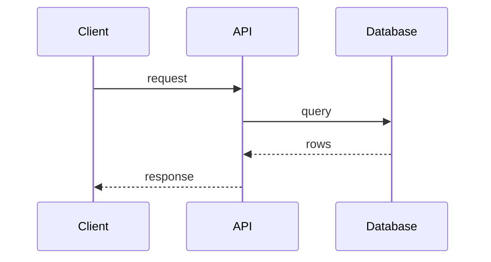

# Technical Design: Feature Name

**Status:** Draft
**Owner:** Name/role
**Specification:** SPEC-NNNN
**Ticket:** KAB-NNN
**Related ADRs:** ADR-NNNN
**Last updated:** YYYY-MM-DD

## 1. Context

Link the spec. Summarize the problem in two sentences.

## 2. Proposed design

Describe the approach and why it fits the existing architecture.

## 3. Module changes

| Module | Change | New public surface |
| --- | --- | --- |
| | | |

## 4. Data model

- New/changed tables, fields, constraints, indexes.
- Migration strategy.
- Backfill plan.

## 5. API changes

- Endpoints, request/response, errors.
- OpenAPI impact.
- Versioning impact.

## 6. Sequence

## 7. Background work

- Jobs, queue, retries, idempotency.
- Failure states and visibility.

## 8. Authorization

- Who can do what.
- Object-level checks.
- Staff paths.

## 9. Security

- Trust boundaries.
- Input validation.
- Upload/AI risks.
- Rate limits.
- Logging restrictions.

## 10. Performance

- Expected query counts.
- Indexes.
- Pagination.
- Caching (only if justified).
- Load assumptions.

## 11. Failure handling

| Failure | Detection | Behaviour | Recovery |
| --- | --- | --- | --- |
| | | | |

## 12. Testing

- Unit/service cases.
- API cases.
- Frontend cases.
- E2E journey.
- Security cases.
- AI evaluation (if applicable).

## 13. Rollout and rollback

- Migration order.
- Feature flag.
- Monitoring.
- Rollback steps.

## 14. Alternatives considered

| Option | Why rejected |
| --- | --- |
| | |

## 15. Open questions

1. ...
